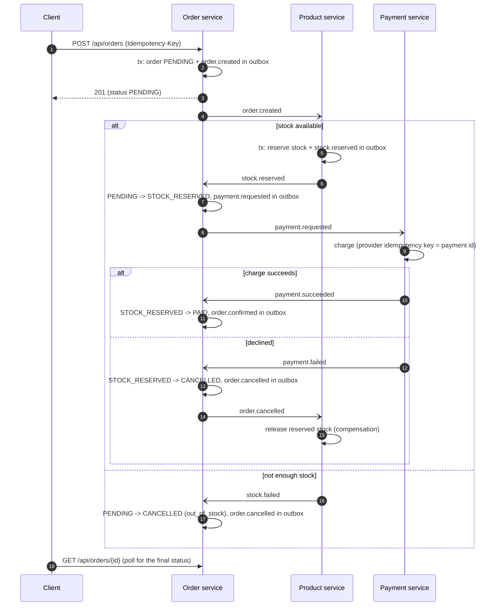
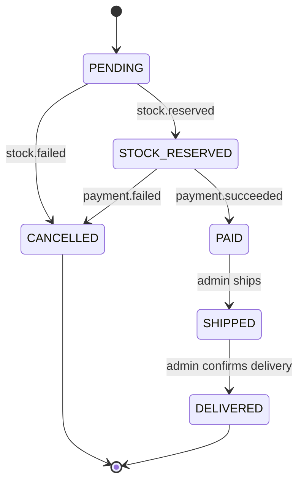

# Event contract and checkout saga

Services communicate over one RabbitMQ **topic exchange**, `ecommerce.events`. The routing key is the event type.
The JSON files in [`fixtures/`](fixtures) are the single source of truth for payload shapes: every service's
contract tests load them, producers must emit exactly that shape, and consumers must parse them.

## Envelope

```json
{
  "id": "uuid",                  // unique per event; consumers de-duplicate on it
  "type": "order.created",       // also the routing key
  "version": 1,
  "occurred_at": "2026-11-21T08:00:00.000Z",
  "correlation_id": "uuid",      // the order id: follow one checkout across every service
  "data": { }
}
```

Consumers are **tolerant readers**: unknown extra fields are ignored, so a producer can add fields without
breaking anyone. Removing or renaming a field requires a new `version`.

## Events

| Type | Produced by | Consumed by | `data` |
|---|---|---|---|
| `order.created` | order | product | `order_id`, `items[{product_id, quantity}]` |
| `stock.reserved` | product | order | `order_id` |
| `stock.failed` | product | order | `order_id`, `failures[{product_id, reason}]` |
| `payment.requested` | order | payment | `order_id`, `user_id`, `amount_minor`, `currency`, `payment_method` |
| `payment.succeeded` | payment | order | `order_id`, `payment_id`, `amount_minor`, `currency` |
| `payment.failed` | payment | order | `order_id`, `payment_id`, `reason` |
| `order.cancelled` | order | product, notification (Phase 5) | `order_id`, `reason` |
| `order.confirmed` | order | notification (Phase 5) | `order_id`, `user_id`, `total_minor`, `currency` |
| `order.shipped` | order | notification (Phase 5) | `order_id`, `user_id` |
| `order.delivered` | order | notification (Phase 5) | `order_id`, `user_id` |

`stock.failed.failures[].reason` is one of `insufficient_stock`, `not_found`, `inactive`.
Payment details (`payment_method`) travel only to the payment service. The product service never sees them.

## Checkout saga

The **Order service coordinates**: it owns the order status, reacts to each outcome, and emits the next step.
Product and payment are simple reactive services. This keeps payment data out of the product service and makes
the order status the single source of truth.



## Order state machine



Invalid transitions are rejected. Every transition is recorded in `order_status_history`.

## Delivery guarantees

RabbitMQ gives **at-least-once** delivery. Exactly-once *effects* come from two patterns used by every service:

- **Transactional outbox.** A state change and the events it implies are written in the same database transaction.
  A relay publishes outbox rows with publisher confirms and marks them published only after the broker confirms.
  A crash between "published" and "marked" causes a duplicate, never a lost event.
- **Idempotent inbox.** Each consumer records the event id in the same transaction as its effect. A redelivered
  event hits the unique key and is acknowledged without doing the work again.

Domain-level guards back this up: the product service keeps one reservation per order (unique), payments are unique
per order, and order status changes are validated by the state machine under a row lock.

## Queues, retries and dead letters

Each consumer owns a queue `<service>.events` bound to the routing keys it consumes:

| Queue | Bindings |
|---|---|
| `product-service.events` | `order.created`, `order.cancelled` |
| `order-service.events` | `stock.reserved`, `stock.failed`, `payment.succeeded`, `payment.failed` |
| `payment-service.events` | `payment.requested` |

On a handler failure the message is re-published to `<queue>.retry` (a TTL queue that dead-letters back into the
main queue after the delay) with an incremented `x-retries` header. After the maximum number of attempts, or for a
permanent error (malformed JSON, invalid payload), it goes to `<queue>.dlq` and is acknowledged. Inspect and
replay dead letters from the RabbitMQ management UI (http://localhost:15672, "Move messages" on the DLQ).

## Failure scenarios

| Failure | What happens |
|---|---|
| Client retries `POST /api/orders` with the same `Idempotency-Key` | The original order is returned; no second order. |
| Same key with a different body | `422`, the request is rejected. |
| Broker down when an order is created | The order is committed with its event in the outbox; the relay publishes when the broker returns. |
| Service crashes after publishing, before marking the outbox row | The event is published twice; the consumer's inbox drops the duplicate. |
| Product service crashes mid-reservation | The transaction rolls back (no partial reservation); redelivery retries it. |
| Not enough stock | `stock.failed`; the order is cancelled with reason `out_of_stock` and `order.cancelled` is published (nothing was reserved, so there is nothing to release). |
| Payment declined | `payment.failed`, order cancelled with reason `payment_failed`, `order.cancelled` releases the stock. |
| Payment provider unavailable | The message is retried with delay; after the maximum attempts it lands in the DLQ. |
| Crash after the provider charged, before the result was saved | The retry reuses the same provider idempotency key, so the customer is not charged twice. |
| Same event delivered twice | Inbox de-duplication; the effect happens once. |
| `order.cancelled` arrives before `order.created` | The product service records a tombstone, so the late `order.created` reserves nothing. |
| `stock.reserved` arrives for an already cancelled order | The order service re-sends `order.cancelled` so the stock is released. |
| `payment.succeeded` arrives for a cancelled order | Logged as an error ("refund required"); automatic refunds are a known gap, see below. |

## Known limitations (planned next)

- **No saga timeout.** An order stuck in `PENDING` or `STOCK_RESERVED` (for example a message stranded in the DLQ)
  is not cancelled automatically. A reaper job plus refund handling for late payments comes with observability work.
- **No refunds or customer cancellation yet.** `REFUNDED` and user-initiated cancel are not implemented.
- **Outbox rows are never purged.** Add a retention job before running this at scale.
- **Relay ordering** is per replica. With several replicas, events of one order are still safe because every
  consumer validates the state machine, but strict global order is not guaranteed.
